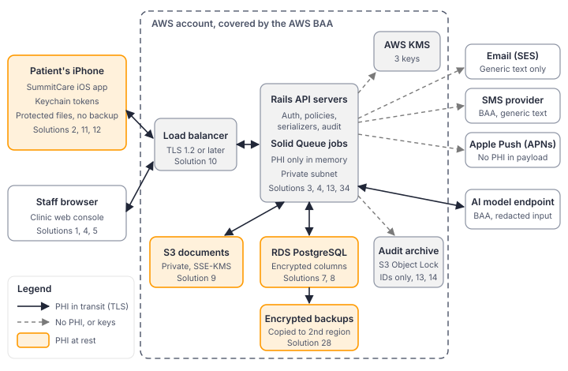

<p align="center">
  <a href="https://skyeroad.com">
    <picture>
      <source media="(prefers-color-scheme: dark)" srcset=".github/assets/srs-lockup.png">
      
    </picture>
  </a>
</p>

<h1 align="center">SummitCare</h1>

<p align="center">
  <strong>HIPAA safeguards as working code.</strong><br>
  The companion code for <em>A Primer on HIPAA for Healthcare Systems Developers</em>.
</p>

<p align="center">
  <a href="LICENSE"></a>
  
  
  
  
</p>

---

The HIPAA Security Rule tells you what to protect. It doesn't tell you how to
build it. SummitCare is a small patient portal (a Rails API, a staff console,
and an iOS app) that implements all 35 safeguards from the book in runnable
form. Each control has the test that proves it works: MFA with replay
protection, encrypted PHI columns, a tamper-evident audit trail, break-glass
access, patient record exports, de-identification, breach scoping, and more.

Use it to see how a control fits into a real codebase, to borrow a pattern, or
to give your security reviewer something concrete to look at.

> [!WARNING]
> **This is teaching code, not a product.** SummitCare is a fictional health
> system. Every patient, clinician, medical record number (MRN), phone number,
> key and host in this repository is synthetic, and `*.example` hosts don't
> exist. The code is not production-ready and has not been reviewed by counsel
> or a security assessor. Don't deploy it, and don't load real protected
> health information (PHI) into it. Code implements safeguards; it doesn't make
> anyone HIPAA compliant on its own.

<p align="center">
  
</p>

## What's here

| Directory | What it is |
|---|---|
| [`summitcare-api/`](summitcare-api) | Rails 8.1 API (plus a small staff console) on PostgreSQL 16 |
| [`SummitCare/`](SummitCare) | Swift 6 / SwiftUI iOS 26 app, a Notification Service Extension, and unit tests, generated with XcodeGen |
| [`BOOK-CORRECTIONS.md`](BOOK-CORRECTIONS.md) | Code fixes found while building this repository, all since applied to the book |

## Learn more

- **The book.** *A Primer on HIPAA for Healthcare Systems Developers*
  (Skye Road Systems, 2026) explains the regulation behind each control, the
  design trade-offs, and the mistakes teams make. Its Solution numbers match
  the table below.
- **The free series.** [HIPAA for developers](https://skyeroad.com/blog/)
  walks through one safeguard a week on the Skye Road blog.

## Running the API and its tests

Requirements: Ruby 3.3.6, PostgreSQL 16, Bundler.

```sh
cd summitcare-api
bundle install

# Create the database roles the audit-table grants rely on (Solution 13)
psql -U postgres -f db/roles.sql

# Create, migrate and seed the development database with synthetic data
SEED_PASSWORD='a-long-local-only-passphrase' bin/setup --skip-server

# Run the suite (every "Proving It" test plus the Solution 35 control tests)
bin/rails db:test:prepare
bin/rails test

# Scans (Solution 33)
bin/brakeman --no-pager
bundle exec bundler-audit check --update
bin/check_vendor_sdks
```

If PostgreSQL runs on a socket or host other than the default, set `PGHOST`,
`PGUSER` and `PGPASSWORD`. The test and development credential keys are
committed on purpose so the suite runs out of the box. Production keys are
not in the repository.

Nothing in the test suite touches the network:

- AWS clients (S3, KMS, SNS, Bedrock Runtime, RDS) run with
  `Aws.config[:stub_responses] = true`.
- `ApnsClient` is a stub that records pushes.
- `OutboundGuard` rejects any host that isn't in `config/vendors.yml`.
- Partner FHIR calls are stubbed in the tests that use them.

## Generating the Xcode project

Requirements: Xcode 26 and [XcodeGen](https://github.com/yonaskolb/XcodeGen).

```sh
cd SummitCare
xcodegen generate
open SummitCare.xcodeproj
```

`project.yml` defines three targets: `SummitCare` (the app),
`SummitCareNotificationService` (an app extension that shares `TokenStore`
through the keychain access group), and `SummitCareTests`. The development
team ID `ABCDE12345` and the `summitcare.example` domains are placeholders.
Replace them before you sign the project.

## Where each Solution lives

Paths are relative to `summitcare-api/` (Rails) or `SummitCare/` (iOS).

### A. Identity and Access

| # | Solution | Rails | iOS |
|---|---|---|---|
| 1 | Identify Every User and Authenticate Strongly | `app/models/user.rb`, `app/models/user/mfa.rb`, `app/models/recovery_code.rb`, `app/models/webauthn_credential.rb`, `app/controllers/concerns/authentication.rb`, `app/controllers/concerns/passkey_challenges.rb`, `app/controllers/sessions_controller.rb`, `app/controllers/console/*`, `app/controllers/api/v1/passkey_*_controller.rb`, `config/initializers/webauthn.rb`, `config/breached_passwords.txt`; tests `test/models/user_mfa_test.rb`, `test/models/webauthn_credential_test.rb`, `test/integration/passkey_test.rb`, `test/integration/console_session_test.rb` | n/a |
| 2 | Sign In with Passkeys and Face ID | uses Solution 1's passkey endpoints | `Security/PasskeyAuthenticator.swift`, `Security/BiometricGate.swift`, `Security/TokenStore.swift`, `Features/SignIn/SignInView.swift`, `SummitCare.entitlements`, `well-known/apple-app-site-association` |
| 3 | Issue Short-Lived Tokens to the App | `app/models/device_session.rb`, `app/controllers/concerns/api_authentication.rb`, `app/controllers/api/v1/token_refreshes_controller.rb`, `app/controllers/api/v1/sessions_controller.rb`; test `test/integration/token_refresh_test.rb` | `Networking/APIClient.swift`, `Networking/Endpoints.swift`, `Security/TokenStore.swift` |
| 4 | Enforce Role-Based Access and Minimum Necessary | `app/policies/*`, `app/serializers/*`, `app/models/care_team_membership.rb`, `app/controllers/application_controller.rb`; tests `test/policies/patient_policy_test.rb`, `test/integration/minimum_necessary_test.rb` | n/a |
| 5 | Log Users Off Automatically | `app/models/concerns/session_expiry.rb`, `app/controllers/concerns/authentication.rb`; test `test/integration/session_timeout_test.rb` | `Security/SessionManager.swift`, `Security/LockScreen.swift`, `App/SummitCareApp.swift`, `App/RootView.swift`; `SummitCareTests/SessionManagerTests.swift` |
| 6 | Provide Break-Glass Emergency Access | `app/models/break_glass_grant.rb`, `app/controllers/concerns/break_glass_access.rb`, `app/controllers/api/v1/break_glass_grants_controller.rb`, `app/mailers/break_glass_mailer.rb`; test `test/integration/break_glass_test.rb` | n/a |

### B. Encryption and Data Protection

| # | Solution | Rails | iOS |
|---|---|---|---|
| 7 | Encrypt PHI Columns at Rest | `app/models/concerns/protected_health_information.rb`, `app/models/patient.rb`, `config/initializers/blind_index.rb`; test `test/models/patient_encryption_test.rb` | n/a |
| 8 | Manage and Rotate Encryption Keys | `lib/summit_care/wrapped_keys.rb`, `app/jobs/reencrypt_phi_job.rb`, `config/application.rb` | n/a |
| 9 | Store Documents and Images Securely | `app/models/document.rb`, `app/controllers/api/v1/documents_controller.rb`, `config/storage.yml`, `infra/phi-documents-bucket-policy.json`; test `test/integration/document_download_test.rb` | `Features/Records/DocumentDownloader.swift`, `Features/Records/RecordsView.swift` |
| 10 | Encrypt Everything in Transit | `config/environments/production.rb` (`force_ssl`, HSTS) | `Info.plist` (ATS), `Networking/AllowedHosts.swift`, `Networking/APIClient.swift`; `SummitCareTests/TransportSecurityTests.swift` |
| 11 | Protect PHI Stored on the Device | n/a | `Security/ProtectedFileStore.swift`, `Models/CachedAppointment.swift`, `Security/TokenStore.swift`; `SummitCareTests/ProtectedFileStoreTests.swift` |
| 12 | Keep PHI Out of iOS Side Channels | `app/services/push_payload.rb`, `app/controllers/api/v1/notification_previews_controller.rb` | `Security/PrivacyShield.swift`, `Security/CaptureStateReader.swift`, `Support/SensitivePasteboard.swift`, `Features/LabResults/LabResultActivity.swift`; `SummitCareTests/SideChannelTests.swift` |

### C. Audit and Integrity

| # | Solution | Rails | iOS |
|---|---|---|---|
| 13 | Record Every Access to PHI | `app/models/audit_event.rb`, `app/services/audit_log.rb`, `app/controllers/concerns/audits_phi_access.rb`, `db/migrate/20261001090*`, `db/roles.sql`; test `test/integration/*` (audit assertions) | n/a |
| 14 | Make the Audit Trail Tamper-Evident | `app/models/audit_event.rb` (hash chain), `app/jobs/audit_chain_verification_job.rb`, `app/jobs/audit_archive_job.rb`, `app/models/control_run.rb`; tests `test/models/audit_event_chain_test.rb`, `test/jobs/audit_archive_job_test.rb` | n/a |
| 15 | Keep PHI Out of Logs and Crash Reports | `config/initializers/filter_parameter_logging.rb`, `config/initializers/lograge.rb`, `config/initializers/sentry.rb`, `app/jobs/application_job.rb`; tests `test/config/filter_parameters_test.rb`, `test/config/sentry_scrubbing_test.rb`, `test/integration/phi_log_leak_test.rb` | `Support/PHILogger.swift` |
| 16 | Detect Improper Changes to Records | `app/models/clinical_version.rb`, `config/initializers/paper_trail.rb`, `db/migrate/20261003*`, `app/models/lab_result.rb`, `app/controllers/api/v1/lab_results_controller.rb` (`update`); tests `test/models/lab_result_integrity_test.rb`, `test/integration/paper_trail_whodunnit_test.rb` | `Features/Records/DocumentVerifier.swift` |
| 17 | Review Activity and Alert on Anomalies | `app/jobs/access_anomaly_scan_job.rb`, `app/models/anomaly_finding.rb`, `app/models/activity_review.rb`, `app/mailers/compliance_mailer.rb`, `config/recurring.yml`; tests `test/jobs/access_anomaly_scan_job_test.rb`, `test/config/recurring_schedule_test.rb` | n/a |

### D. Patient Rights

| # | Solution | Rails | iOS |
|---|---|---|---|
| 18 | Let Patients Get Their Records | `app/models/record_request.rb`, `app/jobs/record_export_job.rb`, `app/jobs/record_request_deadline_job.rb`, `app/services/record_export_pdf.rb`, `app/services/fhir_export/bundle_builder.rb`, `app/controllers/api/v1/record_exports_controller.rb`, `app/mailers/record_request_mailer.rb`; tests `test/models/record_request_test.rb`, `test/jobs/record_request_deadline_job_test.rb` | `Features/Records/RecordsModel.swift`, `Features/Records/RecordsView.swift` |
| 19 | Account for Disclosures | `app/models/disclosure.rb`, `app/models/accounting_request.rb`, `app/services/disclosure_accounting.rb`, `app/services/disclosure_gate.rb`, `app/services/insurer_records_release.rb`, `app/jobs/public_health_report_job.rb`, `app/services/state_public_health_client.rb`; test `test/services/disclosure_test.rb` | n/a |
| 20 | Handle Amendment Requests | `app/models/amendment_request.rb`, `app/models/record_amendment.rb`, `app/models/concerns/amendable.rb`, `app/controllers/api/v1/amendment_requests_controller.rb`, `app/jobs/amendment_notification_job.rb`, `app/mailers/amendment_mailer.rb`; test `test/models/amendment_request_test.rb` | `Features/Records/AmendmentRequestForm.swift` |
| 21 | Honor Communication Preferences and Authorizations | `app/models/communication_preference.rb`, `app/models/patient_authorization.rb`, `app/services/patient_notifier.rb`, `app/jobs/sms_delivery_job.rb`; test `test/services/patient_notifier_test.rb` | `Features/Settings/ContactPreferencesModel.swift`, `Features/Settings/ContactPreferencesView.swift` |
| 22 | De-identify Data for Analytics and AI | `app/services/deidentify/*`, `app/models/patient_surrogate.rb`, `app/models/analytics/*`, `app/models/analytics_daily_count.rb`, `app/jobs/deidentified_export_job.rb`, `config/restricted_zip3.yml`, `db/analytics_migrate/*`; test `test/services/deidentify/safe_harbor_test.rb` | n/a |

### E. Vendors, Integrations, and AI

| # | Solution | Rails | iOS |
|---|---|---|---|
| 23 | Enforce the BAA Boundary in Code | `config/vendors.yml`, `app/lib/vendor_registry.rb`, `app/lib/outbound_guard.rb`, `app/lib/http_client.rb`, `bin/check_vendor_sdks`; test `test/lib/outbound_guard_test.rb` | `Networking/AllowedHosts.swift` |
| 24 | Send Notifications Without Leaking PHI | `app/services/push_payload.rb`, `app/services/patient_notifier.rb`, `app/jobs/push_delivery_job.rb`, `app/services/apns_client.rb`, `app/mailers/patient_mailer.rb`, `app/controllers/api/v1/notification_previews_controller.rb`; test `test/services/push_payload_test.rb` | `SummitCareNotificationService/*` |
| 25 | Use AI Models with PHI Safely | `app/services/bedrock_llm_client.rb`, `app/services/phi_redactor.rb`, `app/services/clinical_assistant.rb`; test `test/services/clinical_assistant_test.rb` | n/a |
| 26 | Use Analytics Without Disclosing PHI | `app/controllers/api/v1/analytics_events_controller.rb` | `Support/Analytics.swift`, `PrivacyInfo.xcprivacy`, `bin/check_no_tracking`; `SummitCareTests/AnalyticsEventTests.swift` |
| 27 | Integrate Securely with Partners | `app/models/partner.rb`, `app/models/partner_credential.rb`, `app/models/webhook_receipt.rb`, `app/controllers/concerns/verifies_webhook_signature.rb`, `app/controllers/api/v1/partners/lab_results_controller.rb`, `app/services/fhir_client.rb`, `config/certs/README.md`; test `test/controllers/api/v1/partners/lab_results_controller_test.rb` | n/a |

### F. Resilience, Retention, and Incidents

| # | Solution | Rails | iOS |
|---|---|---|---|
| 28 | Back Up and Restore Encrypted Data | `infra/rds-backups.sh`, `infra/s3-replication.json`, `app/jobs/backup_restore_drill_job.rb`, `app/models/backup_restore_drill.rb`, `app/services/restore_integrity_check.rb` | n/a |
| 29 | Retain and Dispose of Data on Schedule | `config/retention.yml`, `app/models/retention_policy.rb`, `app/models/legal_hold.rb`, `app/jobs/retention_purge_job.rb`, `app/services/document_disposal.rb`; test `test/jobs/retention_purge_job_test.rb` | n/a |
| 30 | Handle Lost Devices and Departing Staff | `app/controllers/api/v1/device_sessions_controller.rb`, `app/controllers/concerns/api_authentication.rb`, `app/services/offboarding.rb`; tests `test/services/offboarding_test.rb`, `test/integration/device_revocation_test.rb` | `Security/LocalDataWiper.swift`, `App/AppModel.swift`, `Features/Settings/SettingsView.swift` |
| 31 | Detect and Respond to a Breach | `app/models/incident.rb`, `app/models/incident_affected_patient.rb`, `app/services/incident_scope.rb`, `docs/incident-runbook.md`; test `test/models/incident_test.rb` | n/a |

### G. Secure Development and Operations

| # | Solution | Rails | iOS |
|---|---|---|---|
| 32 | Keep Real PHI Out of Development and Testing | `lib/synthea_importer.rb`, `db/seeds.rb`, `test/fixtures/*`, `config/initializers/production_data_guard.rb`; test `test/initializers/production_data_guard_test.rb` | `Preview Content/*` |
| 33 | Scan Code and Dependencies | `.github/workflows/security.yml`, `.github/workflows/ci.yml`, `.github/dependabot.yml`, `bin/check-image-scan` | `.github/dependabot.yml` |
| 34 | Run on HIPAA-Eligible Infrastructure | `config/deploy.yml`, `.kamal/secrets`, `Dockerfile`, `infra/summitcare-app-policy.json`, `infra/README.md`, `config/database.yml` | n/a |
| 35 | Test Your Controls Automatically | `test/controls/*`, `lib/evidence_pack.rb`, `lib/tasks/compliance.rake` | `SummitCareTests/SecurityControlTests.swift` |

## Notes and known gaps

- **Not compiled.** The Swift sources were written against the iOS 26 SDK
  headers and type-checked by reading only. No Swift toolchain was available
  when this code was built, so expect to fix small compile errors on first
  build.
- **Stubs:**
  - APNs (`ApnsClient`) is a stub.
  - Every AWS client is stubbed in tests.
  - `RestoreIntegrityCheck` and `BackupRestoreDrillJob` need a real restored RDS instance, so no test exercises them.
  - The iOS `ContactPreferencesModel` doesn't send a save request to the API.
- **Rails 8.1.** The API runs on Rails 8.1.4 with `config.load_defaults 8.1`.
  Brakeman reports no warnings, and bundler-audit reports no vulnerabilities.
- **Solution 27 test.** The partner test sends a bearer API key as well as
  the HMAC signature, because the controller authenticates the credential
  before it checks the signature. The test has a comment explaining this.
- **`state_public_health` in `config/vendors.yml`.** This entry is a
  public-health authority, not a business associate. It has a
  `baa_signed_on` date only because `VendorRegistry` requires one for any
  host that receives PHI. The comment beside the entry explains this.

## Credits

Portions of `summitcare-api` were generated by Ruby on Rails 8 (`rails new` and `bin/rails generate authentication`) and then modified. Ruby on Rails is © David Heinemeier Hansson and Rails contributors and is released under the MIT License.

## License

The code is released under the [MIT License](LICENSE). The book's text is not;
it is © 2026 Skye Road Systems, Inc.

## About Skye Road Systems

<a href="https://skyeroad.com"></a>

[Skye Road Systems](https://skyeroad.com) builds AI and custom software for
small and mid-sized businesses, with deep roots in healthcare and medical
devices. If you're building software that touches patient data and want the
safeguards designed in from the start, get in touch at
[info@skyeroad.com](mailto:info@skyeroad.com).
